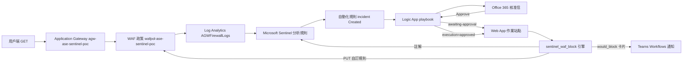
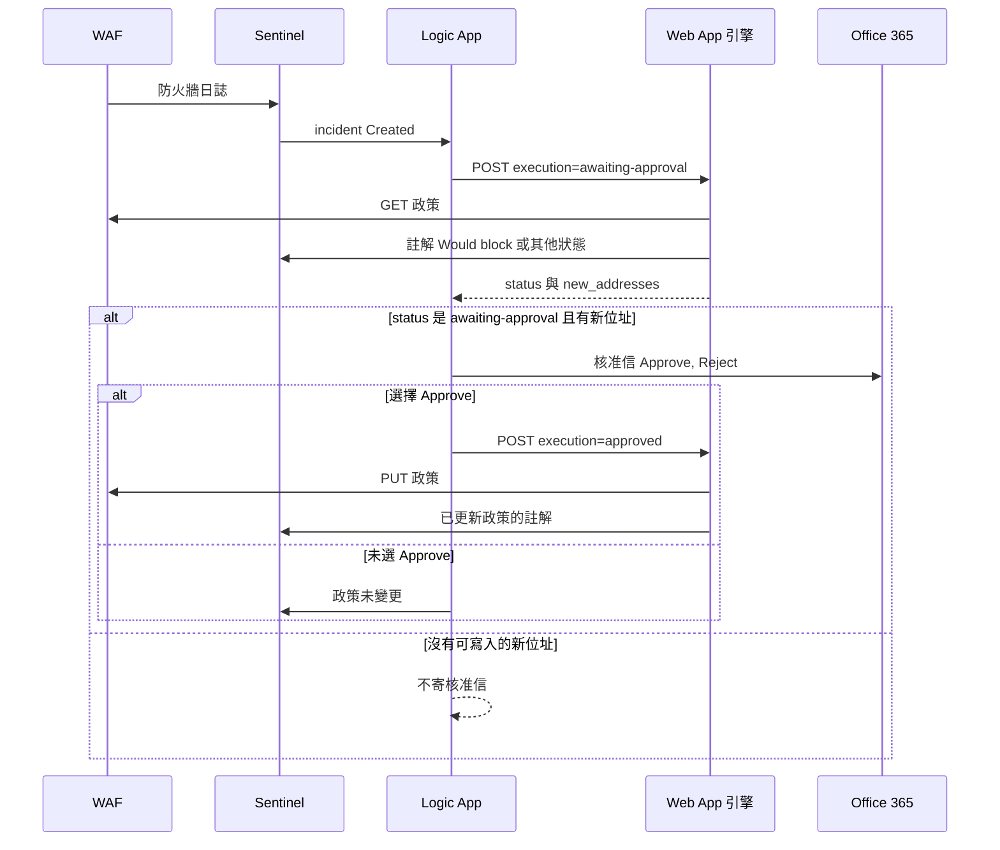

# ASE Microsoft Sentinel 系統設計規格

## 1. 文件基本資訊

| 項目 | 內容 |
| --- | --- |
| 文件名稱 | ASE Microsoft Sentinel 系統設計規格 |
| 版本 | 0.1 |
| 文件日期 | 2026-11-02 |
| 檢視分支 | `feature/laptop-sentinel-ops`，commit `7a291a6` |
| 適用環境 | 訂用帳戶 `ME-MngEnvMCAP591832-v-henchang-1`（`ae4654a2-8a96-431c-ad3d-176ae51ec9d8`），資源群組 `rg-ase-sentinel-poc` |
| 維護角色 | 待 ASE 指定。本文件由程式庫與一次唯讀 Azure 檢視產生 |
| 適用對象 | ASE 技術審查、架構與安全審查、第二座工廠複製、後續工程 |

### 1.1 目的

記錄這套 POC **實際存在**的偵測、核准與 WAF 封鎖設計。讀文件的工程師應能分辨哪些行為已在 Azure 上、哪些只存在程式、哪些仍是提案。

### 1.2 狀態用語

| 狀態 | 意義 |
| --- | --- |
| 已實作且已在 Azure 驗證 | 本次唯讀查詢看得到對應資源或設定 |
| 已實作但未於本次驗證 Azure | 程式或 IaC 有實作，本次沒有重讀該資源 |
| 部分實作 | 程式、部署腳本與線上資源不一致，或只完成路徑的一段 |
| 規劃 / 提案 | 討論過或檔案留著，但不是目前線上路徑 |
| 未知 / 待確認 | 沒有足夠證據 |

### 1.3 版本紀錄

| 版本 | 日期 | 說明 |
| --- | --- | --- |
| 0.1 | 2026-11-02 | 依 `feature/laptop-sentinel-ops` 與該日唯讀 Azure 檢視初版 |

### 1.4 範本限制

`docs/模組設計說明書範本 v0.1.docx` 的檔頭是 OLE Compound Document（`D0 CF 11 E0`），不是可解壓的 Office Open XML。本次無法抽出範本的標題、表格與章節，因此採用任務指定的十章結構，沒有依該範本編排。

### 1.5 證據優先順序

實作宣稱對應到儲存庫路徑，或對應到本次 Azure 唯讀結果。本次沒有修改任何 Azure 資源。檢視結束後，Azure CLI 的預設訂用帳戶已回到檢視前的 `ME-MngEnvMCAP965121-ACase-DEV`。

## 2. 專案背景與需求

### 2.1 背景與痛點

ASE 希望用 Microsoft Sentinel 與 Azure 原生自動化，處理 Application Gateway WAF 看到的可疑來源，減少人員重複查 IP、再手動改 WAF 政策的工作。一座工廠已有這套 POC。另一座工廠要複製時，必須接受環境差異，不能把這份 POC 的資源名稱當成每座工廠的固定值。

### 2.2 建置目標

1. 用可重複的模擬探測產生 WAF 日誌，而不是發送攻擊流量。
2. Sentinel 依來源 IP 開事件。
3. 事件建立時啟動 Logic App。
4. 先做 dry-run，不寫 WAF。
5. 核准人在 Office 365 核准信選擇 Approve 之後，才把位址寫進 WAF 自訂規則。
6. 拒絕、逾時、呼叫失敗時，不假設政策已變更。

### 2.3 功能需求

| 編號 | 需求 | 狀態 |
| --- | --- | --- |
| FR-1 | WAF 擋下帶 `ase-poc-probe` 的 GET，並把防火牆日誌送到 Log Analytics | 已實作且已在 Azure 驗證：政策 `wafpol-ase-sentinel-poc` 為 Prevention，規則 `PocSimulatedProbe` 存在。日誌表與分析規則本次未重跑查詢 |
| FR-2 | 同一來源 IP 在觀察窗內達到門檻才開事件 | 已實作於 `sentinel/analytics-rules/simulated-probe.application-gateway.kql` 與 `infra/parameters/main.bicepparam`（門檻 3、頻率 5 分鐘、回看 30 分鐘）。線上規則內容本次未重讀 |
| FR-3 | 只在事件 Created 時跑 playbook | 已實作於 `sentinel/automation-rules/block-malicious-ip.bicep`。線上自動化規則本次未重讀 |
| FR-4 | 抽出 IP、拒絕私有與保留位址、先 dry-run | 已實作於 `webapp/sentinel_waf_block/`。作業 Web App 只有這條讀取路徑，playbook 呼叫該站點 |
| FR-5 | Office 365 Approve 之後才 `execution=approved` | 已實作於 `playbooks/block-malicious-ip/thin-workflow.json`。連線資源存在；本次未開啟一筆新的核准。線上 Logic App 尚未換成這份定義 |
| FR-6 | 寫入 `SentinelAutoBlock`，已存在的位址不重複寫 | 已實作。線上該規則為 IPMatch、priority 10、Enabled，match value 數量為 6 |
| FR-7 | Teams 通知，卡片不是核准按鈕 | 已實作於 `webapp/sentinel_waf_block/notifiers.py`。線上有 `NOTIFY_TEAMS_AUTH=entra` 與 `NOTIFY_TEAMS_URL`（值不列入文件）。本次未驗證卡片是否送達 |
| FR-8 | 作業頁面讀 Sentinel 與 WAF | 已實作於 `webapp/app/live.py`。站點 Running。本次未以瀏覽器登入驗證畫面 |

### 2.4 非功能需求

| 編號 | 需求 | 實際作法 |
| --- | --- | --- |
| NFR-1 | 沒有核准就不改政策 | `AUTO_BLOCK_ENABLED` 必須是 JSON boolean `true` 才會 PUT。字串 `"true"` 不算。線上值為 `false`。Playbook 只在核准後送 `execution=approved`，該欄位會把這一次請求的旗標改成 true |
| NFR-2 | 失敗時可追溯 | Sentinel 事件註解由引擎撰寫。Logic App 在呼叫失敗或核准失敗時另外寫註解。註解要讀者自己看政策，不把 HTTP 失敗解讀成已封鎖 |
| NFR-3 | 機密不進範本與日誌 | Teams URL、`x-functions-key`、App Insights 連線字串不寫進本文件。`azure_clients.py` 會把例外改寫後再拋出 |
| NFR-4 | 可在另一座工廠重建 | 參數在 `scripts/deploy.ps1` 與 `infra/parameters/main.bicepparam`。線上 Web App 的部署不在這個腳本的成功路徑裡，見部署指南與落差報告 |

### 2.5 範圍與非範圍

範圍內：

- eastus 的測試 Application Gateway、WAF 政策、Log Analytics、Sentinel、Logic App、作業 Web App。
- 模擬探測標記 `ase-poc-probe`。
- 核准後更新 Application Gateway WAF 自訂規則。

非範圍，或僅有程式、尚未成為線上路徑：

- Azure Front Door。KQL 與引擎有分支，`scripts/deploy.ps1` 明確不建立 Front Door 本體與它的診斷設定。
- 真實惡意流量偵測、自動解除封鎖、封鎖到期。
- `webapp-workflow.json`。Bicep 載入的是 `thin-workflow.json`（`infra/modules/playbook.bicep`）。
- 作業資料庫。應用程式不開 SQLite 或 Azure SQL。`/health` 仍回 `sql: false`。2026-11-02 已刪除 `app-ase-sentinel-poc-7ttpll74-sql`、資料庫 `aseops`、私人端點與 `privatelink.database.windows.net`。
- `infra/modules/webapp.bicep` 沒有被 `infra/main.bicep` 引用，而且不再描述 Azure SQL。

### 2.6 限制與假設

- 測試閘道的後端位址在 `infra/modules/waf.bicep` 寫死為 `192.0.2.10`（`backendDummy`）。不在封鎖名單上的一般請求會落到這個不回應的後端。
- 公開 IP 資源名稱是 `pip-ase-sentinel-poc`。位址本身本次未重查。
- 分析規則排除規則名稱等於 `SentinelAutoBlock` 的列，避免封鎖之後又開新事件。若位址寫進 `SentinelAutoBlock-2` 這類延伸規則，現行程式的 KQL 只排除精確名稱 `__BLOCK_RULE__`，延伸規則名稱不在排除條件內。此點是實作落差，不是已驗證的線上行為。線上目前只有一條 `SentinelAutoBlock`。
- 客戶保護範圍若有一筆無法解析，整次執行失敗，不採用其餘已解析的範圍（`addresses.py` 的 `parse_protected_ranges`）。
- 事件路徑只接受一筆純 IPv4 主機。手動新增才接受 IPv4 CIDR，且客戶範圍的 prefix 只允許 8、16、24、32。

## 3. 系統架構設計

### 3.1 整體架構

線上路徑是：Application Gateway WAF 產生日誌，Sentinel 開事件，Logic App 編排，作業 Web App 內的 Python 引擎讀寫 WAF。Azure Function App `fn-ase-sentinel-poc-7ttpll74` 在本次資源清單中不存在（ARM 回 `ResourceNotFound`）。Playbook 參數 `functionUrl` 的主機是 `app-ase-sentinel-poc-7ttpll74.azurewebsites.net`，路徑是 `/api/SentinelWafAutoBlock`。



### 3.2 Azure 資源與職責

本次 `az resource list -g rg-ase-sentinel-poc` 的結果。職責來自資源類型與程式，不是门户顯示名稱的推測。

| 資源 | 類型 | 區域 | 職責 | 狀態 |
| --- | --- | --- | --- | --- |
| `log-ase-sentinel-poc-7ttpll74bmhiq` | Operational Insights workspace | eastus | 日誌與 Sentinel | 已在 Azure |
| `SecurityInsights(log-ase-sentinel-poc-7ttpll74bmhiq)` | Operations Management solution | eastus | Sentinel 方案 | 已在 Azure |
| `agw-ase-sentinel-poc` | Application Gateway | eastus | 測試入口，SKU 在設定檔期望為 WAF_v2 | 已在 Azure。SKU 本次未重讀 |
| `pip-ase-sentinel-poc` | Public IP | eastus | 閘道前端 | 已在 Azure。位址本次未重讀 |
| `wafpol-ase-sentinel-poc` | WAF policy | eastus | Prevention。探測規則與封鎖規則 | 已在 Azure 驗證 mode、state、規則摘要 |
| `wafpol-ase-sentinel-poc-2` | WAF policy | eastus | 自訂規則數 0。標籤 `ManagedBy=manual`，沒有 `ase-sentinel-block-list=true` | 已在 Azure。用途待確認 |
| `vnet-ase-sentinel-poc` | Virtual Network | eastus | 測試閘道網路 | 已在 Azure。位址空間本次未重讀 |
| `playbook-ase-sentinel-poc-block-malicious-ip` | Logic App | eastus | 編排。Enabled，系統受控識別 | 已在 Azure |
| `azuresentinel-playbook-ase-sentinel-poc-block-malicious-ip` | API connection | eastus | Sentinel 連接器。Bicep 使用受控識別 | 資源已在。授權狀態本次未查 |
| `office365-playbook-ase-sentinel-poc-block-malicious-ip` | API connection | eastus | Office 365 核准。Bicep 註明必須由核准人在入口網站授權一次 | 資源已在。授權狀態本次未查 |
| `app-ase-sentinel-poc-7ttpll74` | App Service，Linux，Python 3.11 | centralus | 作業頁面與 `POST /api/SentinelWafAutoBlock`。Running，HTTPS only | 已在 Azure |
| `app-ase-sentinel-poc-7ttpll74-plan` | App Service plan | centralus | 站點方案 | 已在 Azure。SKU 本次未重讀 |
| `appi-ase-sentinel-poc` | Application Insights | eastus | 遙測 | 已在 Azure。範本不再建立它。是否仍有資料源，待確認 |
| `st7ttpll74bmhiq` | Storage | eastus | 原先 Function 部署的儲存體 | 已在 Azure。Function 已不在 |
| `vnet-app-ase-sentinel-poc-7ttpll74` | Virtual Network | centralus | Web App 的 VNet integration，只剩 `snet-app` | 2026-11-02 重讀。Web App 仍整合到這個子網路。私人端點子網路、其 NSG、私人 DNS 與 Azure SQL 已刪除 |

不在清單中：`fn-ase-sentinel-poc-7ttpll74`。ARM 讀取該站點回 `ResourceNotFound`。

### 3.3 元件互動

1. 用戶端對閘道送出 `GET /?ase-poc-probe=1`。`scripts/test.ps1` 用這個規則組 URI。
2. `PocSimulatedProbe`（priority 50，operator Contains）比對查詢字串。`SentinelAutoBlock`（priority 10，IPMatch，RemoteAddr）先被評估。已在封鎖名單上的來源不會再落到探測規則。
3. 診斷設定預期寫入 `AGWFirewallLogs`。設定名稱在 `profiles/poc-approval.json` 為 `diag-waf-to-sentinel`。本次未重讀診斷設定。
4. 分析規則彙總後開事件。分組 lookback 在 Bicep 為 `PT12H`，且 `reopenClosedIncident` 在設定檔的期望值是 false。
5. 自動化規則把事件標成 `poc-simulated-probe` 並啟動 playbook。條件是相關分析規則 ID。
6. Playbook 取 IP 實體，POST `execution=awaiting-approval` 到 Web App。
7. 引擎驗證、讀政策、寫 Sentinel 註解、視事件類型送 Teams。
8. 只有 `status` 是 `awaiting-approval` 且 `new_addresses` 長度大於 0 才寄核准信。
9. Approve 之後第二次 POST，`execution=approved`，引擎 PUT 政策。

### 3.4 資料流

- 日誌：WAF 動作、規則 ID、ClientIp、RequestUri，進入 `AGWFirewallLogs`。
- 事件：Sentinel incident 的 ARM id、編號、標題，加上 IP 實體。
- 引擎輸入：`incidentArmId`、`incidentNumber`、`incidentTitle`、`ipEntities`、`execution`。
- 引擎輸出：`status`、`changed`、`new_addresses`、`rejected_addresses`、`written_rule`、`written_priority` 等，見 `models.py` 的 `Result.to_dict`。
- 政策：自訂規則陣列。封鎖規則的 match variable 是 `RemoteAddr`，operator 是 `IPMatch`。Application Gateway 的否定欄位沿用 API 接受的拼法 `negationConditon`（`waf_arm.py` 註明 `2024-05-01` 拒絕更正後的拼法）。

### 3.5 控制流



### 3.6 信任邊界

| 邊界 | 信任方式 |
| --- | --- |
| 網際網路到閘道 | 公開 IP。WAF Prevention |
| Logic App 到 Web App | HTTPS，標頭 `x-functions-key` 必須與 `BLOCK_API_KEY` 以常數時間比較相符。Easy Auth 必須排除這條路徑，否則核准流程打不到引擎。排除路徑本次未重讀 authsettings |
| 瀏覽器到作業頁面 | 程式使用 Easy Auth 的 `X-MS-CLIENT-PRINCIPAL`，另有本機密碼登入。生產環境 `validate()` 在 live 模式禁止設定 `DEV_LOGIN_PASSWORD` |
| Web App 到 ARM | `DefaultAzureCredential`。線上應為站點系統受控識別。本次未重讀該識別的角色指派 |
| Logic App 到 Sentinel | Bicep 的 Sentinel 連接器使用受控識別 |
| Logic App 到 Office 365 | 使用者 OAuth。沒有受控識別替代方案。空的核准郵件地址會在評估前停止 |

### 3.7 區域

封鎖鏈的閘道、政策、workspace、playbook 在 eastus。作業 Web App 在 centralus。這是部署結果，不是 `infra/parameters/main.bicepparam` 的單一 `location` 可以解釋的。第二座工廠不應假設 Web App 必須跟閘道同區，也不應假設可以照搬 centralus。Azure SQL 已於 2026-11-02 從資源群組移除。

## 4. 模組設計規格

### 4.1 Application Gateway 與 WAF

- 職責：測試入口與兩類自訂規則。探測規則製造可重複事件。封鎖規則依來源 IP 拒絕後續請求。
- 狀態：已實作且已在 Azure 驗證政策 mode `Prevention`、state `Enabled`。`SentinelAutoBlock` priority 10、Block、Enabled、IPMatch、6 個 match value。`PocSimulatedProbe` priority 50、Block、Enabled、Contains、1 個 match value。
- 觸發：每個符合規則的 HTTP 請求。
- 設定來源：`infra/modules/waf.bicep`、`infra/parameters/main.bicepparam`。
- 錯誤處理：本模組不重試應用程式邏輯。未封鎖的請求落到 `192.0.2.10`。
- 稽核：`AGWFirewallLogs`、`AGWAccessLogs`。本次未重查表內資料。
- 相關檔案：`infra/modules/waf.bicep`、`scripts/test.ps1`。

官方限制與本專案常數：

- Microsoft Learn 記載一個 WAF 政策最多 100 條自訂規則，IPMatch 只支援 IPv4，且 Match Variable 為 RemoteAddr。[Custom rules overview](https://learn.microsoft.com/en-us/azure/web-application-firewall/ag/custom-waf-rules-overview)
- 每個 match condition 的 IP 範圍數量，Microsoft Q&A 引用服務限制：CRS 3.2 或更新為 600，CRS 3.1 或更早為 540。一條 CIDR 算一筆。這是產品限制說明，不是本次對這份政策的 CRS 版本查核。
- 程式常數 `MATCH_VALUES_PER_POLICY = 600`、`MAX_CUSTOM_RULES = 100`（`webapp/sentinel_waf_block/models.py`、`waf_arm.py`）。
- `select_block_list` 用 600 判斷一條規則是否還有空間。滿了就在同一政策建立下一條 `SentinelAutoBlock-<n>`。新的一批本身超過 600、自訂規則已達 100，或 priority 1–100 已滿時回 `capacity-exceeded`，不 PUT。`MAXIMUM_BLOCK_ENTRIES` 已從程式與 App Settings 移除。

### 4.2 Log Analytics 與 Sentinel 分析規則

- 職責：從 `AGWFirewallLogs` 找出探測，依 ClientIp 計數，排除封鎖規則名稱、私有位址、內建保護範圍與 watchlist。
- 狀態：查詢與 Bicep 已實作。workspace 已在 Azure。分析規則物件本次未重讀，標為已實作但未於本次驗證 Azure。
- 門檻與排程的參數檔預設：`detectionThreshold=3`、`queryFrequencyMinutes=5`、`queryLookbackMinutes=30`、`probeMarker=ase-poc-probe`。
- 分組：`infra/modules/sentinel.bicep` 的 `lookbackDuration` 為 `PT12H`。
- Watchlist 名稱在 `profiles/poc-approval.json` 為 `AseWafIpAllowlist`。KQL 用 `column_ifexists('IPAddress')`，避免 watchlist 結構尚未出現時規則部署失敗。
- 相關檔案：`sentinel/analytics-rules/simulated-probe.application-gateway.kql`、`sentinel/queries/verify-application-gateway.kql`、`infra/modules/sentinel.bicep`。

### 4.3 自動化規則

- 職責：事件 Created，且相關分析規則符合時，先把狀態改為 Active 並加上標籤 `poc-simulated-probe`，再 `RunPlaybook`。
- 狀態：Bicep 已實作。線上規則本次未重讀。
- 部署注意：`sentinel/automation-rules/block-malicious-ip.bicep` 寫明 Sentinel 會拒絕 `RunPlaybook`，直到 Azure Security Insights 服務主體在 playbook 所在資源群組擁有 Microsoft Sentinel Automation Contributor。這個規則要在獨立部署中建立。
- 同一張仍開啟的事件不會再次觸發 Created，因此 12 小時分組窗內的後續探測不會再跑 playbook。

### 4.4 Logic App / Playbook

- 名稱：`playbook-ase-sentinel-poc-block-malicious-ip`。
- 定義檔：`playbooks/block-malicious-ip/thin-workflow.json`。`infra/modules/playbook.bicep` 以 `loadJsonContent` 載入此檔。
- 狀態：Logic App Enabled、系統受控識別、呼叫 URL 指向作業 Web App。定義是否與儲存庫檔案逐字相同，本次沒有做完整 diff，標為部分實作驗證：只確認頂層動作名稱、狀態、URL 主機與路徑、以及存在 `functionKey` 參數。
- 頂層動作：`Entities_-_Get_IPs`、`Add_comment_-_entities_failed`、`Terminate_-_entities_failed`、`Select_IP_addresses`、`Check_function_url`。核准與第二次呼叫巢狀在條件內。
- 輸入：Sentinel incident 觸發內容。輸出：兩次以內的 HTTP POST，以及 Sentinel 註解。
- HTTP：方法 POST，標頭 `x-functions-key`，`retryPolicy` 為 none，逾時 `PT2M`，`DisableAsyncPattern`。
- 核准：`Start_and_wait_for_an_approval`，選項 `Approve, Reject`。`SelectedOption` 以小寫比較，只有 `approve` 會送 `execution=approved`。
- 空的 `approverEmail`：寫註解後以 Succeeded 結束，不呼叫引擎。
- 相關檔案：`playbooks/block-malicious-ip/thin-workflow.json`、`playbooks/block-malicious-ip/README.md`、`infra/modules/playbook.bicep`。

`workflow.json` 是運算式實作。`playbookMode=full` 時 `infra/modules/playbook-full.bicep` 才載入它。預設 `thin` 不載入。這份文件觀察到的線上 Logic App 仍是 thin 定義，尚未換成 `workflow.json`。`webapp-workflow.json` 有測試 `webapp/tests/test_playbook.py`，不是 Bicep 載入的定義。

### 4.5 封鎖引擎

- 模組：`webapp/sentinel_waf_block/`。
- 進入點：`service.execute_payload`。Web App 路由在 `webapp/app/live.py` 的 `POST /api/SentinelWafAutoBlock`。
- 狀態：程式已實作，且線上 playbook 指向這個路由。本次沒有對該路由送測試 POST。
- 處理：
  1. 手動呼叫帶 `operation` 為 `add` 或 `remove` 時，走 `add_entry` 或 `remove_entry`，不寫事件註解。
  2. 否則把本文解析成 `Incident`。
  3. `execution=approved` 把 `auto_block_enabled` 設為 true。`execution=awaiting-approval` 設為 false。省略則用環境設定。`dry-run` 與 `enforce` 回 HTTP 400。
  4. `enforcement_enabled` 只接受 Python boolean `True`。
- 依賴：ARM `https://management.azure.com`，範圍 `https://management.azure.com/.default`。GET 讀取逾時 20 秒、最多 3 次，只對逾時重試。PUT 逾時預設 120 秒、不重試。HTTP 202 視為失敗，呼叫端必須先讀政策再決定要不要重做。
- 設定：見第 6 章。缺 `WAF_POLICY_RESOURCE_ID` 或 `WAF_PROVIDER` 時，`config_from_env` 丟出 `ConfigError`，HTTP 500，`status=validation-failed`。
- 日誌：`status`、`changed`、事件編號與計數。不記錄 Teams URL 或要求本文。
- `function-app/` 已從儲存庫移除。引擎只在 `webapp/sentinel_waf_block/`。

### 4.6 Microsoft 365 核准

- 實作位置：Logic App 的 Office 365 連接器動作，不是 Teams 卡片上的按鈕。
- 狀態：連接器資源已在 Azure。是否仍為已授權，本次未查，標為待確認。
- 授權：Bicep 註明 `office365` 連接器不接受受控識別，操作者必須用核准人帳戶在入口網站授權一次。
- 失敗：核准動作失敗或未在期限內回答時，playbook 寫「未收到核准」註解，政策不應被第二次呼叫改寫。期限的實際分鐘數在連接器動作上，本次未把該分鐘數從線上定義摘出。

### 4.7 通知

- `TeamsWorkflowNotifier` 對 `https://` 的 Workflows URL 送 Adaptive Card。
- `NOTIFY_TEAMS_AUTH=entra` 時，對 `https://service.flow.microsoft.com/` 取受控識別權杖。此 audience 必須完全相符，含結尾斜線。官方說明：[OAuth authentication for Power Automate](https://learn.microsoft.com/en-us/power-automate/oauth-authentication)。
- 尚未寫入時，HTTP `status` 是 `awaiting-approval`。卡片 Fact 的 Status 也是 `awaiting-approval`。Playbook 依 HTTP `status == awaiting-approval` 且 `new_addresses` 有值才寄核准信，不讀卡片文字。寫入成功的 HTTP `status` 是 `approved`。Teams 事件名稱仍是 `would_block` 與 `blocked`，用來對上 `NOTIFY_EVENTS`。
- 線上 `NOTIFY_EVENTS=would_block,blocked,put_failed,capacity`。
- 通知失敗會回到結果的 `notify_error`，並可寫進 Sentinel 註解。通知失敗本身不會把 `changed` 設成 true。

### 4.8 作業頁面

`webapp/app/main.py` 一律使用 `build_live_app`，不開資料庫。

`webapp/app/live.py` 路由：

| 路由 | 行為 |
| --- | --- |
| `GET /health` | `status=ok`、`liveAzure=true`、`sql=false` |
| `POST /api/SentinelWafAutoBlock` | 金鑰比對後呼叫引擎 |
| `GET /` | 沒有主體就導向 `/login` |
| `GET /incidents/{incident_id}` | 讀 Sentinel 事件與 IP 實體 |
| `POST /incidents/{incident_id}/block` 與 `/dismiss` | 頁面動作 |
| `GET /blocks`、`POST /blocks`、`POST /blocks/remove` | 讀取與手動增刪封鎖項目 |

狀態：程式已實作，站點 Running。本次未登入驗證畫面，也未確認 Easy Auth 排除路徑是否包含 `/api/SentinelWafAutoBlock` 與 `/health`。Playbook 能把 URL 指到這個路徑，只能證明設定如此，不能取代一次成功的呼叫紀錄。

SQL 頁面、SQLAlchemy 與記憶體 WAF fixture 已從 `webapp/app/` 移除。稽核仍是 Sentinel 註解與 Logic App run。

### 4.9 第二份 WAF 政策

`wafpol-ase-sentinel-poc-2` 存在、Prevention、Enabled、0 條自訂規則，標籤含 `ManagedBy=manual`，沒有 `ase-sentinel-block-list=true`。`BLOCK_POLICY_TAG` 這個設定名稱存在於 Web App，但 `select_block_list` 與 `service.execute_payload` 只對 `WAF_POLICY_RESOURCE_ID` 指向的那一份政策做 PUT。因此第二份政策目前不被這條寫入路徑選為目標。它為什麼存在，標為待確認。

## 5. 核心業務流程

### 5.1 狀態與決策

| 條件 | `status` | 是否 PUT | Playbook 下一步 |
| --- | --- | --- | --- |
| `execution` 不是空字串、`awaiting-approval`、`approved` | HTTP 400，`validation-failed` | 否 | 呼叫失敗分支，不假設已封鎖 |
| 沒有可執行位址 | `nothing-to-block` | 否，且可能尚未讀政策 | 不進入核准 |
| 保護範圍有無法比較的項目 | `protected-ranges-invalid` | 否 | 不進入核准 |
| 讀政策失敗或資源 ID 不是 ARM id | `waf-get-failed` | 否 | 不進入核准 |
| 政策形狀不符 | `policy-shape-invalid` | 否 | 不進入核准 |
| 位址都已在封鎖規則 | `already-blocked` | 否 | 不進入核准 |
| 規則已滿且不能再新增自訂規則 | `capacity-exceeded` | 否 | 不進入核准 |
| 有新位址且這次不寫入 | `awaiting-approval` | 否 | 若 `new_addresses` 非空，寄核准信 |
| 有新位址且 `execution=approved` 或設定為 JSON true | `approved`，`changed=true` | 是 | 第二次呼叫的結果由引擎寫註解 |
| PUT 失敗或只得到 202 | `waf-put-failed`，`changed=false` | 不把失敗當成已寫入 | 核准後的失敗註解要讀者去讀政策 |
| 未處理例外 | HTTP 500，`internal-error` | 未知，必須讀政策 | 呼叫失敗分支 |

核准信只在第一次回應同時滿足 `status == awaiting-approval` 且 `new_addresses` 長度大於 0 時發出。`already-blocked`、`nothing-to-block`、`capacity-exceeded` 都不會寄信。

### 5.2 IP 擷取與驗證

Playbook 的 `Select_IP_addresses` 把實體動作選出的位址放進 `ipEntities`。引擎對事件路徑呼叫 `canonical_host`：

- 空白、空白字元、逗號、`%`、或含 `/` 的字串：拒絕，理由 `empty, CIDR, or whitespace`。
- 非正規 IPv4：拒絕。
- 落在 `0.0.0.0/8`、`10.0.0.0/8`、`100.64.0.0/10`、`127.0.0.0/8`、`169.254.0.0/16`、`172.16.0.0/12`、`192.168.0.0/16`：拒絕，除非 `OVERRIDE_PROTECTED_RANGES` 是 JSON `true`。線上該值為 `false`。
- 另外比對 `PROTECTED_IP_RANGES`。線上有此設定名稱。本次未摘錄內容，避免把客戶範圍寫進文件。設定檔預設是空陣列。

同一事件裡重複的正規位址只保留一次。

### 5.3 寫入與重複

`merge_addresses` 以字串相等判斷已存在，保留政策上原有的文字，不重新壓縮 CIDR。`select_block_list` 先找名稱為 `SentinelAutoBlock` 或以 `SentinelAutoBlock-` 開頭、且合併後不超過 600 的規則。都滿了才開新規則，直到自訂規則總數 100，或 priority 1 到 100 沒有空位。

空的 match value 陣列不會留在政策上。移除最後一個位址時，`build_put_body` 刪掉該規則而不是 PUT 空陣列。

### 5.4 失敗與回復

- Playbook HTTP 不重試。引擎 GET 只重試逾時。
- 兩次 PUT 沒有鎖。並行的兩個 run 可能互相覆蓋。並行控制標為未實作。
- 回復方式是再讀政策，用引擎的 `remove`，或依 `README.md` 的手動編輯方式拿掉 match value。沒有一鍵還原整份政策的實作。
- `scripts/deploy.ps1` 檔頭寫明不要對目前的資源群組執行該腳本，因為主範本會重布 playbook，可能清掉 Office 365 授權。

### 5.5 手動移除

已實作於引擎 `remove_entry`，以及 live 頁面 `POST /blocks/remove`。移除需要通過頁面主體檢查。本次未在 Azure 上執行移除。

## 6. API 與資料規格

### 6.1 `POST /api/SentinelWafAutoBlock`

標頭：`Content-Type: application/json`，`x-functions-key` 等於 `BLOCK_API_KEY`。不符時 HTTP 401，`reason=unauthorized`。

事件本文：

```json
{
  "incidentArmId": "/subscriptions/.../providers/Microsoft.SecurityInsights/incidents/...",
  "incidentNumber": 1,
  "incidentTitle": "ASE POC - simulated WAF probe",
  "ipEntities": ["203.0.113.10"],
  "execution": "awaiting-approval"
}
```

`incidentNumber` 可為整數或沒有前後空白的字串。`incidentArmId` 必須以 `/` 開頭。`execution` 可省略。合法值是 `awaiting-approval` 與 `approved`。

手動本文：

```json
{
  "operation": "add",
  "address": "203.0.113.0/24",
  "execution": "approved"
}
```

`operation` 只允許 `add` 或 `remove`。作業頁面的手動新增與移除送 `approved`。範例位址是文件用例，不是線上名單。

成功時 HTTP 200，主體為 `Result.to_dict`。驗證失敗 HTTP 400。設定錯誤或未處理例外 HTTP 500。

### 6.2 環境設定

以下名稱出現在線上 Web App，除非該列寫明已刪除。值只列出本次判定為非機密的項目。

| 名稱 | 線上值或狀態 | 用途 | 機密 |
| --- | --- | --- | --- |
| `APP_ENV` | `production` | 區分本機與正式檢查 | 否 |
| `LIVE_AZURE` | 2026-11-04 已從 App Settings 刪除 | 程式不讀。刪除後重啟，`GET /health` 仍回 200 | 否 |
| `AUTO_BLOCK_ENABLED` | `false` | 省略 `execution` 時不 PUT | 否 |
| `OVERRIDE_PROTECTED_RANGES` | `false` | 不略過保護範圍 | 否 |
| `WAF_PROVIDER` | `ApplicationGateway` | 政策形狀 | 否 |
| `BLOCK_RULE_NAME` | `SentinelAutoBlock` | 封鎖規則基底名稱 | 否 |
| `BLOCK_RULE_PRIORITY` | `10` | 新基底規則的 priority | 否 |
| `MAXIMUM_BLOCK_ENTRIES` | 2026-11-04 已從 App Settings 刪除 | 程式不讀。單規則容量是常數 600 | 否 |
| `REQUIRE_APPROVAL` | 2026-11-04 已從 App Settings 刪除 | 程式不讀。核准在 playbook | 否 |
| `SEED_FIXTURE` | 2026-11-02 已從 App Settings 刪除 | 程式不再讀這個旗標 | 否 |
| `NOTIFY_TEAMS_AUTH` | `entra` | Teams 使用受控識別權杖 | 否 |
| `NOTIFY_EVENTS` | `would_block,blocked,put_failed,capacity` | 要送出的事件 | 否 |
| `AZURE_RESOURCE_GROUP` | `rg-ase-sentinel-poc` | 讀 Sentinel 與政策清單 | 否 |
| `SENTINEL_WORKSPACE_NAME` | `log-ase-sentinel-poc-7ttpll74bmhiq` | Sentinel workspace | 否 |
| `WAF_POLICY_RESOURCE_ID` | 已設定，值不摘錄 | PUT 目標 | 資源 ID，視為環境識別資訊 |
| `AZURE_SUBSCRIPTION_ID` | 已設定 | live 模式必要 | 否，值即本 POC 訂用帳戶 |
| `BLOCK_API_KEY` | 已設定 | playbook 共用祕密 | 是 |
| `NOTIFY_TEAMS_URL` | 已設定 | Workflows 觸發 URL | 是 |
| `APP_SECRET`、`MICROSOFT_PROVIDER_AUTHENTICATION_SECRET` | 已設定 | 應用與 Easy Auth | 是 |
| `INTEGRATION_API_KEY` | 2026-11-04 的名稱清單裡沒有 | 程式不讀 | 是 |
| `PROTECTED_IP_RANGES` | 已設定 | 額外保護範圍 | 內容可能是客戶網路，不摘錄 |
| `POC_ADMIN_USERS` | 已設定 | 作業頁面角色 | 不摘錄 |
| `APPROVER_EMAIL`、`PUBLIC_BASE_URL` | 2026-11-04 已從 App Settings 刪除 | 程式不讀。核准信箱只在 playbook 參數 `approverEmail` | 不摘錄 |
| `ARM_API_VERSION`、`BLOCK_POLICY_TAG` | 已設定 | ARM 版本與標籤名 | 本次未摘錄值。程式預設 API 版本在 Application Gateway 為 `2024-05-01`，標籤預設 `ase-sentinel-block-list` |
| `WEBSITES_PORT` | 已設定 | 網站連接埠。啟動命令綁定 `8000` | 否 |
| `SCM_DO_BUILD_DURING_DEPLOYMENT`、`WEBSITE_VNET_ROUTE_ALL`、`WEBSITE_HTTPLOGGING_RETENTION_DAYS` | 已設定 | 平台 | 否 |

啟動命令：`gunicorn -k uvicorn.workers.UvicornWorker -w 1`，綁定 `0.0.0.0:8000`，timeout 230，模組 `app.main:app`。單一 worker 是線上設定，不是 Bicep 預設值的本次核對結果。

### 6.3 註解文字

`comments.py` 依狀態產生 HTML 註解。`awaiting-approval` 的標題是 Awaiting approval，動作行是 `Would block IP: <address>`。`approved` 的標題是 Approved。已在名單上時標題說明位址已在指定自訂規則上，政策沒有再寫一次。PUT 失敗時明確寫「不要假設該位址已封鎖」。

## 7. Security Design

### 7.1 身分與 RBAC

`profiles/poc-approval.json` 現在只描述 playbook 的 Microsoft Sentinel Responder。Function 角色列已刪除。這些列是設定檔期望，不是本次重讀到的角色指派。Web App 在政策 `wafpol-ase-sentinel-poc` 上的 Network Contributor 是既有指派，主範本不會建立它，移除模組也不會刪除它。

| 設定檔中的主體 | 角色定義 ID | 範圍 | 本次狀態 |
| --- | --- | --- | --- |
| Playbook 受控識別 | `3e150937-b8fe-4cfb-8069-0eaf05ecd056` Microsoft Sentinel Responder | 資源群組 | 設定檔仍期望這筆。線上是否存在，本次未重讀 |
| Web App 受控識別 | `3e150937-b8fe-4cfb-8069-0eaf05ecd056` Microsoft Sentinel Responder | 資源群組 | 不在設定檔。線上是否存在，待確認 |
| Web App 受控識別 | `4d97b98b-1d4f-4787-a291-c67834d212e7` Network Contributor | WAF 政策 | 不在主範本。既有指派應保留。本次未重讀 |

Playbook 本身不應擁有 WAF 寫入權。`deploy.ps1` 有 `Remove-PlaybookNetworkContributor`。本次未確認該指派已移除。

### 7.2 核准授權

能改政策的人是收到 Office 365 核准信、且選擇 Approve 的帳戶。Teams 卡片沒有核准動作。`POC_ADMIN_USERS` 影響作業頁面角色，不取代核准信。

頁面上的手動 `add` 或 `remove` 帶 `execution=approved`，會在同一次請求把引擎旗標打開。這是程式行為（`service.py`）。它與 playbook 的核准是兩條授權路徑。上線前必須確認頁面路由有 Entra 登入，且不是匿名可呼叫。

### 7.3 祕密

沒有 Key Vault 參考出現在本次讀到的 Web App 設定名稱裡。`BLOCK_API_KEY`、Teams URL、Easy Auth 祕密與 `APP_SECRET` 是 App Settings。這是 POC 現況，不是建議的正式祕密管理。

### 7.4 網路

測試閘道在 eastus VNet。Web App 在 centralus，並設定 `WEBSITE_VNET_ROUTE_ALL`。2026-11-02 重讀：VNet integration 指向 `vnet-app-ase-sentinel-poc-7ttpll74/snet-app`。這個 VNet 留下。Azure SQL 私人端點已刪除。封鎖 API 走公開 HTTPS 到 `azurewebsites.net`。

### 7.5 防止誤封

- 模擬標記才會進分析規則，加上規則 ID 等於探測規則，或 URI 含標記。
- 分析規則再排除封鎖規則名稱、私有 IP、內建範圍與 watchlist。
- 引擎再拒絕內建範圍與客戶範圍。
- 預設不 PUT。
- 已存在的字串不第二次寫入。
- 空名單不會留下空的 IPMatch 規則。

這些控制降低誤封，但不能防止核准人對一筆模擬事件按 Approve。模擬探測的來源 IP 就是測試用戶端的出口 IP。

## 8. Reliability 與營運設計

### 8.1 已實作

- Playbook 呼叫失敗與核准失敗都寫 Sentinel 註解，並以 Succeeded 結束該分支，避免 Logic App 無限重試同一筆核准。
- GET 逾時重試 3 次。PUT 不重試，202 視為未完成。
- 重複位址以字串比對略過。
- 容量：單條件 600、政策 100 條自訂規則。超過則 `capacity-exceeded`，不寫政策。
- 診斷：playbook 設定檔期望有 `diag-playbook-runtime`。本次未重讀。

### 8.2 未實作或僅為建議

- 沒有跨執行的樂觀鎖定或 ETag 檢查。建議在正式環境比對 PUT 前的政策版本。
- 沒有另外的 100 筆產品上限。thin 與 full 都是每條規則 600，滿了開下一條。若 ASE 要加一個更小的上限，必須改 web app 與 `workflow.json`。App Setting 與 workflow 參數都沒有這個開關。
- 沒有封鎖到期、自動解除、或變更單編號。
- 沒有針對 playbook 失敗或容量拒絕的 Azure Monitor 警示規則。本次資源清單沒有這類警示，只有 Application Insights Smart Detection 動作群組。
- 第二份政策沒有被引擎納入寫入集合。若將來要多政策同步，現況還沒有這條行為。

### 8.3 回復程序

1. 停用自動化規則，或停用 Logic App，讓新事件不再呼叫引擎。Bicep 的自動化規則有 `enabled` 參數。線上停用步驟見部署指南，本次沒有執行。
2. 保持 `AUTO_BLOCK_ENABLED=false`。不要對現有 playbook 送 `execution=approved`，除非這次呼叫就是要寫入。
3. 讀 `wafpol-ase-sentinel-poc` 的 `SentinelAutoBlock.matchValues`，移除不應存在的位址後 PUT 完整政策。不要 PUT 空陣列。若名單會變空，刪除該規則。`README.md` 有相同警告。
4. 讀 Sentinel 註解與 Logic App run，確認哪一次是 `awaiting-approval`、哪一次是 `approved`。

## 9. 限制、風險與後續

### 9.1 POC 限制

- 偵測的是模擬標記，不是攻擊特徵。
- 閘道後端是測試位址，不能拿 HTTP 502 代表正式網站健康。
- 核准信與 Teams 通知依賴租用戶內的連接器與 Power Automate flow。
- 封鎖名單沒有「哪一張事件、哪一位核准人」的欄位。WAF match value 只有字串。理由在 Sentinel 註解與 Logic App run。
- Web App 在 centralus，與 eastus 的政策分開計費與配額。

### 9.2 技術債

- `scripts/deploy.ps1` 不再打包 Function，也不再要求 Function 輸出。它仍會重布 playbook，並把 `functionKey` 留空。不要對現有資源群組執行。
- `infra/main.bicep` 不再引用 `function.bicep`。參數 `blockApiUrl` 預設空字串，傳入 workflow 參數 `functionUrl`。參數名稱維持 `functionUrl` 與 `functionKey`。
- Azure SQL、私人 DNS 與私人端點已於 2026-11-02 刪除。`vnet-app-ase-sentinel-poc-7ttpll74` 仍在，因為 Web App 整合在 `snet-app`。
- 分析規則只排除精確的 `SentinelAutoBlock`。延伸規則 `SentinelAutoBlock-2` 的阻擋日誌可能再被計入探測查詢。目前線上沒有延伸規則。
- workflow 參數名稱維持 `functionUrl` 與 `functionKey`。目標是作業 Web App，不是 Function App。

### 9.3 正式環境前必須補上的保護

- 把部署腳本改成部署現在這條 Web App 路徑，或凍結一份可重建的基礎結構。在那之前不要執行 `scripts/deploy.ps1`。
- 確認 Web App 受控識別只有目標政策的寫入權與 Sentinel 註解所需的 Responder，沒有訂用帳戶層級的寬角色。
- 確認 `/api/SentinelWafAutoBlock` 不能匿名呼叫，且 `BLOCK_API_KEY` 只放在 App Settings 或改到 Key Vault。
- 單規則上限已定為 600。thin 與 full 都用這個數字，滿了就開下一條 `SentinelAutoBlock-<n>`。沒有 100 筆的產品開關。
- 為 playbook 失敗、PUT 失敗與容量拒絕建立警示。
- 第二座工廠改用該工廠自己的核准人、watchlist 與現有 WAF 政策，不要部署這組測試閘道，除非該工廠接受測試後端與模擬標記。

### 9.4 作業 Web App 的定位

它已經是線上 playbook 的呼叫目標，也有讀 Sentinel 與封鎖名單的頁面。它不是獨立的核准系統。核准仍在 Logic App 的 Office 365 動作。應用程式沒有自己的審核資料庫。

## 10. 參考與證據

### 10.1 儲存庫

- `webapp/sentinel_waf_block/engine.py`、`service.py`、`models.py`、`waf_arm.py`、`addresses.py`、`comments.py`、`notifiers.py`、`config.py`、`azure_clients.py`、`decision.py`
- `webapp/app/main.py`、`webapp/app/live.py`、`webapp/app/config.py`
- `playbooks/block-malicious-ip/thin-workflow.json`
- `infra/modules/playbook.bicep`、`waf.bicep`、`sentinel.bicep`、`webapp.bicep`
- `infra/main.bicep`、`infra/parameters/main.bicepparam`
- `sentinel/automation-rules/block-malicious-ip.bicep`
- `sentinel/analytics-rules/simulated-probe.application-gateway.kql`
- `scripts/deploy.ps1`、`scripts/test.ps1`
- `profiles/poc-approval.json`
- `playbooks/block-malicious-ip/README.md`

### 10.2 本次 Azure 唯讀

- 訂用帳戶 `ae4654a2-8a96-431c-ad3d-176ae51ec9d8`，資源群組 `rg-ase-sentinel-poc`。
- 資源清單、兩份 WAF 政策的 mode 與自訂規則摘要、Logic App 狀態與 `functionUrl` 主機和路徑、Web App 非機密 App Settings、站點狀態與啟動命令。
- Function 站點讀取結果為 `ResourceNotFound`。
- 沒有列出 match value、金鑰、Teams URL 或連接字串。

### 10.3 官方文件

- [Application Gateway WAF custom rules](https://learn.microsoft.com/en-us/azure/web-application-firewall/ag/custom-waf-rules-overview)
- [Power Automate OAuth authentication](https://learn.microsoft.com/en-us/power-automate/oauth-authentication)
- IP match value 的 600 筆上限來自 Microsoft Learn Q&A 對 Application Gateway 服務限制的引用，不是本次從限制 API 重查的數字。正式設計若要引用配額，應再對該工廠的 CRS 版本核對一次。

### 10.4 仍待客戶決定的項目

見 `docs/ase/ASE-Sentinel-Documentation-Gaps.md` 第 7 與第 8 節。
